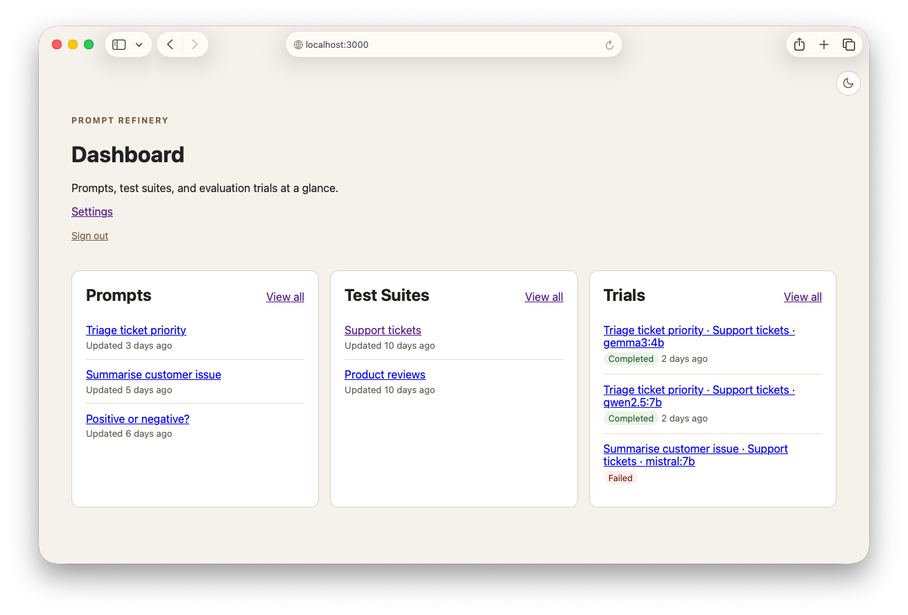
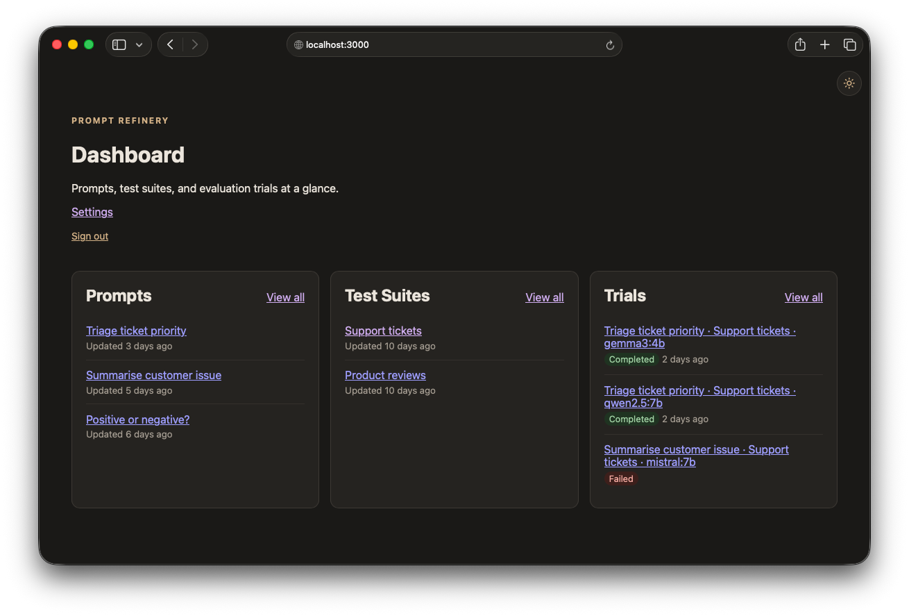

# Prompt Refinery

Prompt Refinery is a local-first tool for evaluating prompts against language models.

It is intended to make prompt experimentation repeatable and easy to review. A prompt can be fixed text or a template whose `{{variables}}` are filled in from the test cases in a test suite. Prompt Refinery runs a prompt against every test case as a tracked trial, preserves the generated outputs, and provides an interface for reviewing, comparing, and scoring the results.

## Goals

- Keep revision history for prompts and reusable test suites.
- Support static prompts and prompts with interpolated input variables.
- Create and monitor trial runs of a prompt across a suite of test cases.
- Preserve prompts, inputs, model settings, outputs, errors, and timing information.
- Review, compare, score, and annotate generated responses.
- Export trial results for further analysis.
- Keep inference and evaluation data on the local machine.

## Screenshots

Prompt Refinery provides a simple dashboard for managing Prompts, Test Suites and Trials:



The app provides a dark mode theme:



## Importing test suites from CSV

A test suite can be created from a CSV file, such as a spreadsheet export. Each column becomes a variable and each row becomes a test case.

1. On the **Test Suites** page, choose a file under **Import from CSV**. Leave **First row contains variable names** ticked if the file has a header row.
2. Review the preview. It shows every test case that was read from the file, and lets you change the suite's name and its variable names before anything is final.
3. Click **Create test suite**, or **Discard import** to delete the suite and the uploaded file.

Until it is confirmed, an imported suite is _provisional_: it doesn't appear in test suite lists and can't be used for trials. After it is confirmed, the original file can be downloaded from the test suite's page. The download is the file as uploaded, so it doesn't reflect later edits to the suite.

How files are read:

- Headers become variable names. Characters other than letters, digits, and underscores are replaced with `_`, accents are removed, and duplicates get a numeric suffix, so `Ticket ID` becomes `Ticket_ID`. Without a header row, columns are named `column_1`, `column_2`, and so on.
- Blank rows, and trailing columns with no header and no values, are ignored. Short rows are padded with empty values. A row with more values than there are columns is rejected.
- Values can span several lines if they are quoted.
- Files must be UTF-8 (a byte order mark is fine), at most 5 MB, with up to 50 columns and 1,000 test cases.

The uploaded files are stored with Active Storage in `storage/`, next to the SQLite databases.

## Model runtime

Prompt Refinery uses [Ollama](https://ollama.com/) to run models locally. Ollama will use a supported GPU when one is available and otherwise fall back to CPU execution.

Backends record the inference adapter they use; only Ollama is currently supported. Create a new backend to switch providers. Trials and both refinement roles preserve the original adapter, backend name, and URL, so later backend edits do not redirect queued work or subsequent refinement iterations.

## Local development

Prompt Refinery is a Rails 8.1 application using Hotwire, SQLite, and Solid Queue. Ruby and Rails run in Docker; Ollama runs locally and is reached from the app at `http://host.docker.internal:11434` by default.

Prerequisites:

- Docker with Compose v2
- [Ollama](https://ollama.com/) running on the host

Start the application:

```sh
scripts/compose.sh
```

Then open http://localhost:3000. Override the Ollama endpoint with `OLLAMA_URL` when needed.

### Authentication

Generate an encrypted authentication token interactively:

```sh
docker compose run --rm app bin/rails prompt_refinery:encrypt_token
```

Add the generated value to the local `.env` file and restart Prompt Refinery:

```dotenv
RAILS_AUTH_TOKEN=<encrypted value>
```

Enter the original plaintext token on the login page. Prompt Refinery stores it in an encrypted, HTTP-only session cookie. You can also use a one-time-style login URL such as `https://prompt_refinery.example.test/?token=<plaintext token>`; Prompt Refinery removes the token from the URL after setting the cookie.

### Demo data

To load sample data for product demos, run:

```sh
docker compose run --rm app bin/rails prompt_refinery:demo:reset
```

This **deletes all existing data**, including prompts, test suites, trials, models, backends, and uploaded CSV files. It then recreates the default Ollama backend and loads the demo data. You will be asked to type `yes` first. Set `CONFIRM=1` to skip the prompt, for example in scripts:

```sh
docker compose run --rm -e CONFIRM=1 app bin/rails prompt_refinery:demo:reset
```

The demo data includes:

- **Prompts:** "Positive or negative?" (sentiment analysis), "Summarise customer issue", "Triage ticket priority", and one archived prompt. Each refined prompt has a loose first revision and an improved second one.
- **Test suites:** "Product reviews", with a second revision that adds sarcastic and misleading reviews, "Support tickets", and "Helpdesk export", imported from [`db/seeds/files/helpdesk_export.csv`](db/seeds/files/helpdesk_export.csv) with its headers renamed to `ticket_id`, `subject`, and `message`. That file is also handy for trying the CSV import yourself.
- **Trials:** completed trials comparing `llama3.2:3b`, `qwen2.5:7b`, and `gemma3:4b`, plus one failed trial for a model that isn't installed.

The responses are pre-written, so loading the demo doesn't call Ollama. The demo models appear in the model list, but new trials on them need the models pulled into Ollama first.

To change the demo data, edit [`db/seeds/demo.rb`](db/seeds/demo.rb) and run the task again. Test suites, prompts, and trials are defined in the order they would be created in the app. Each trial's `outputs` must have one entry per test case in its suite, in order. Use a string for a completed response or `{ error: "..." }` for a failed one. CSV files for imported test suites go in `db/seeds/files/`.

## Other commands

Common commands that you would expect from a Rails application, for testing, tailing logs, etc:

```sh
docker compose run --rm app bin/rails test
docker compose run --rm app bin/rails console
docker compose logs -f app
docker compose down
```

See [PLAN.md](PLAN.md) for the proposed scope, architecture, and delivery milestones.

## License

Prompt Refinery is licensed under the [MIT License](LICENSE).
